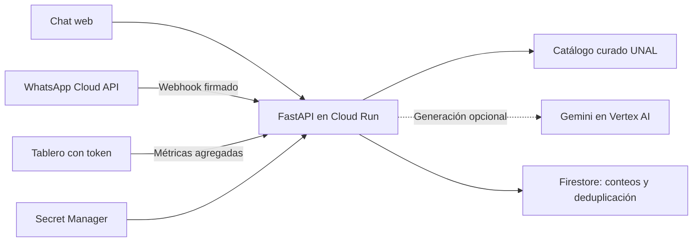

# Arquitectura y operación

Nexo UNAL conecta consultas universitarias con un catálogo revisado de fuentes institucionales. El alcance inicial corresponde a Ciencias de la Computación y servicios de la Sede Bogotá. El catálogo se amplía mediante revisión editorial; esta versión no representa toda la información de la Universidad.

## Consultas

`POST /api/chat` acepta una pregunta de 2 a 2000 caracteres. La búsqueda local normaliza texto y recupera entradas relevantes. El modo extractivo devuelve orientación del catálogo y enlaces. El modo opcional Vertex AI usa esa información como contexto, con instrucciones para evitar datos ajenos a las fuentes. Si falla el proveedor, se conserva la respuesta extractiva. Una respuesta marcada `grounded` indica que se encontraron fuentes; no es una certificación de exactitud ni una evaluación automática de cada afirmación generada.

El contenido tiene que revisarse cuando cambian las fuentes. Los plazos, costos, requisitos y convocatorias deben verificarse en la página institucional correspondiente. El asistente no accede a cuentas SIA ni realiza trámites en nombre del estudiante.

## WhatsApp

`GET /webhooks/whatsapp` realiza el desafío de verificación de Meta. `POST /webhooks/whatsapp` comprueba la firma HMAC SHA-256 sobre el cuerpo original antes de procesar eventos. Los mensajes de texto reciben una respuesta con fuentes. Eventos de estado y formatos no soportados se reconocen sin generar una consulta.

La entrega usa identificadores de mensaje con hash y una reserva temporal. Los eventos ya completados se reconocen sin volver a enviarlos; una reserva pendiente devuelve un error temporal para conservar los reintentos de Meta. La aplicación confirma la métrica de WhatsApp después del envío exitoso. Una caída entre el envío a Meta y la confirmación local puede producir una respuesta duplicada en un reintento: no se promete entrega exactamente una vez.

Este piloto procesa el webhook de forma síncrona. Para mayor volumen se debe introducir una cola duradera, confirmación rápida y un trabajador con reintentos y observabilidad.

## Datos y acceso

- Se guardan conteos por día UTC, tema y canal, conteos con fuentes y sumas de latencia. Retención de métricas: 90 días; los registros de deduplicación expiran a los 7 días.
- No se guardan preguntas, respuestas ni teléfonos en la base de datos. Los textos y el remitente se procesan transitoriamente para responder. WhatsApp es un servicio de Meta. Cuando se activa Vertex AI, la pregunta y las fuentes se envían a Google Cloud.
- El tablero exige `X-Admin-Token`. El token se introduce en un campo de contraseña y se mantiene en memoria de la pestaña; no se guarda en almacenamiento del navegador.
- Cloud Run es público para recibir el webhook y ofrecer el chat. La API de métricas permanece protegida. Los secretos se montan desde Secret Manager, fuera de Git y de los valores Terraform.
- Los registros de acceso de Uvicorn están deshabilitados. Cloud Run puede registrar metadatos HTTP de infraestructura, incluidas rutas y parámetros. Evitar contenido personal en URL, restringir acceso a Cloud Logging y revisar su retención. El `verify_token` de Meta se transmite en la URL de verificación según su protocolo; usar un token distinto de las credenciales de envío.

SQLite sirve para desarrollo local. Firestore permite varias instancias de Cloud Run con contadores atómicos y reservas coordinadas. TTL en Firestore es asíncrono; las consultas de métricas filtran por ventana temporal sin esperar al borrado físico.

## Límites y siguiente etapa

La limitación de consultas web se mantiene por proceso y dirección de conexión. No es una cuota global; antes de una apertura masiva hace falta protección en el borde y una estrategia de cuotas. Los límites de instancias tampoco constituyen un presupuesto de gasto.

La ampliación a toda la U requiere filtros de sede y programa, catálogo versionado, responsables editoriales y un conjunto de preguntas de evaluación que incluya dudas ambiguas, fuera de alcance y fuentes contradictorias. También se prevén seguimiento de satisfacción voluntario, alertas de errores y evaluación periódica de respuestas con fuentes.

Para operar, revisar `/healthz`, las métricas y los fallos de entrega sin registrar cuerpos. Rotar secretos mediante nuevas versiones y actualizar las referencias Terraform. El despliegue público se realiza con una imagen inmutable cuyo digest queda asociado al commit real de Git.
